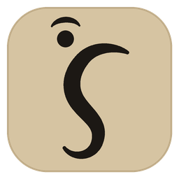
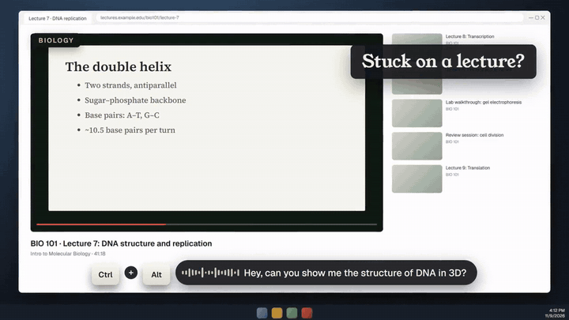
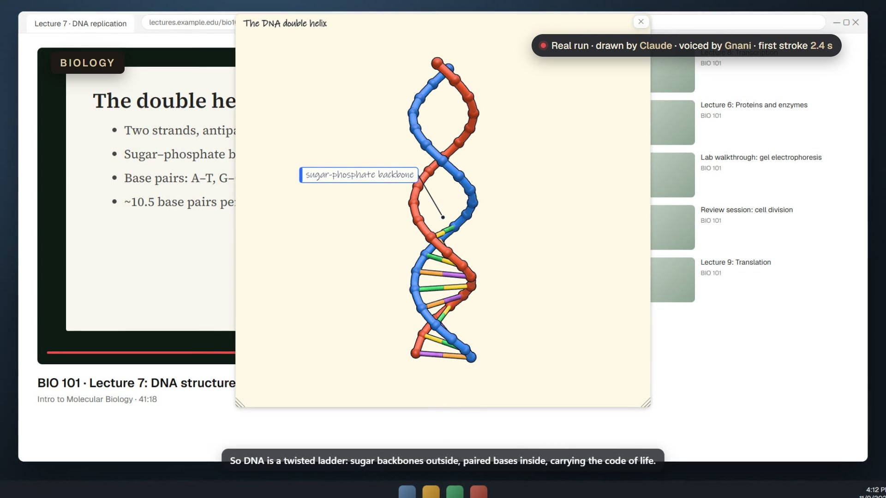
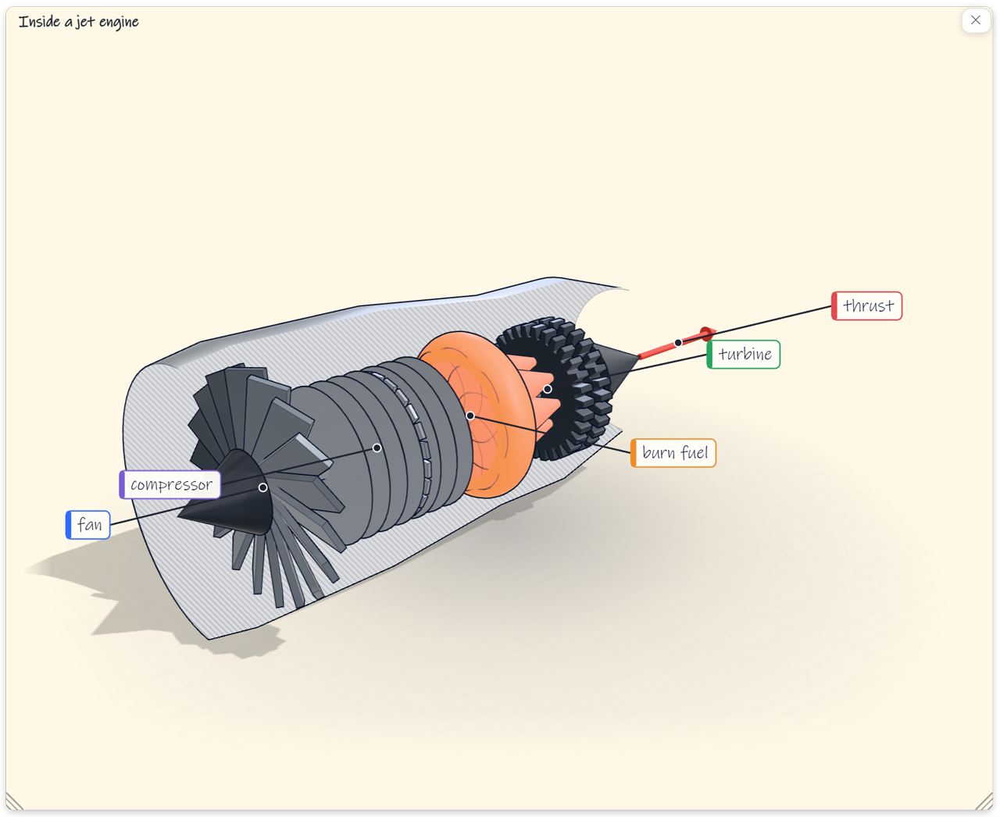
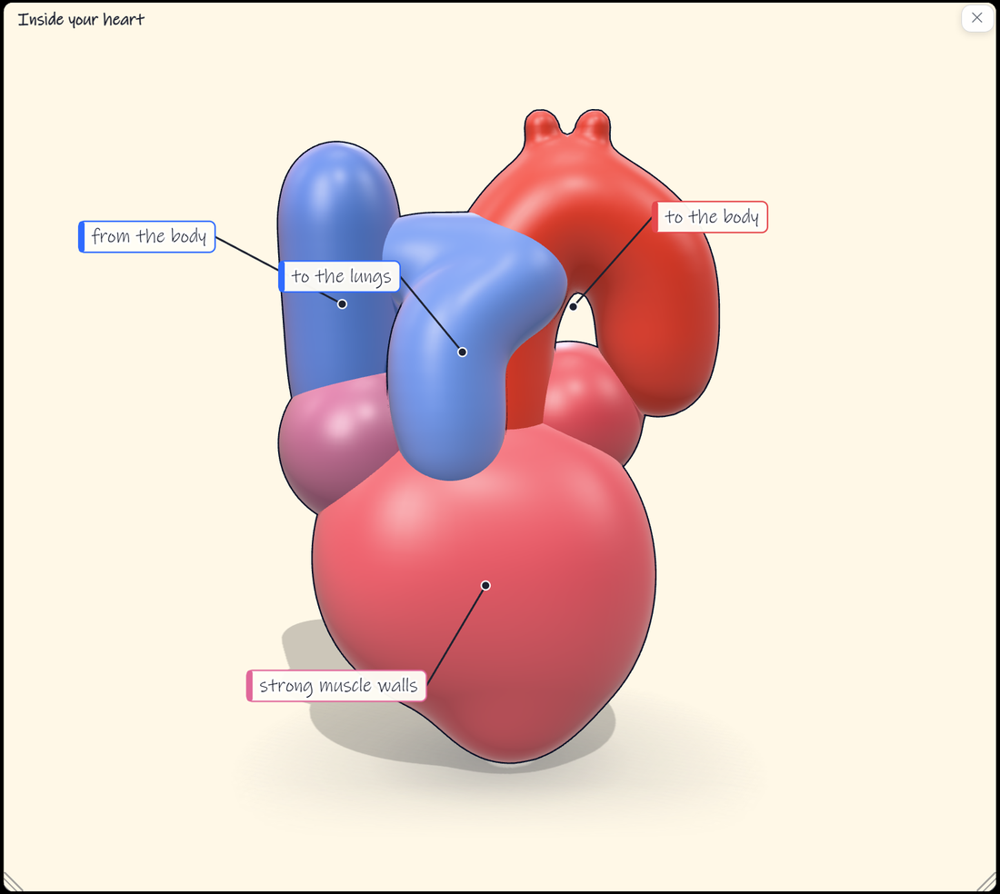
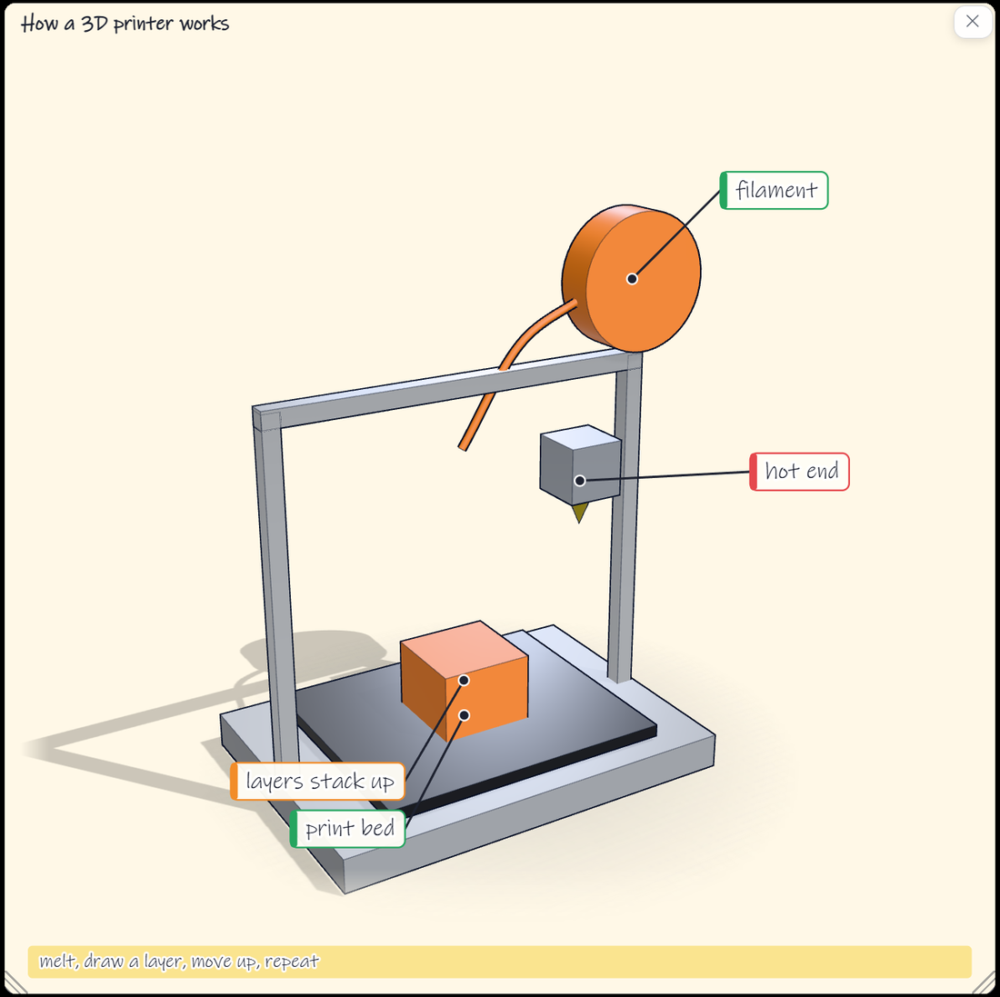
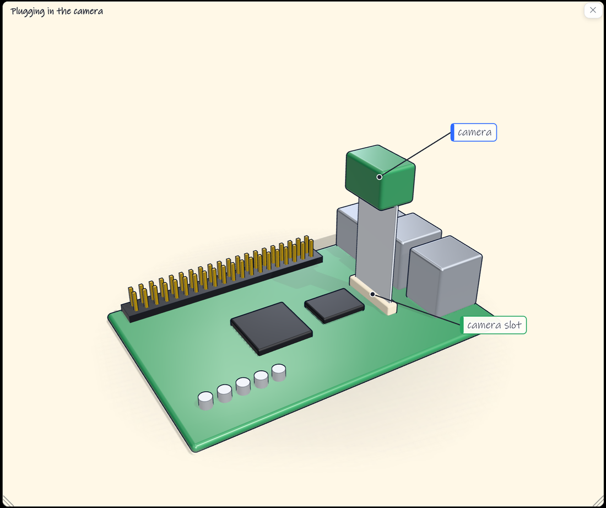
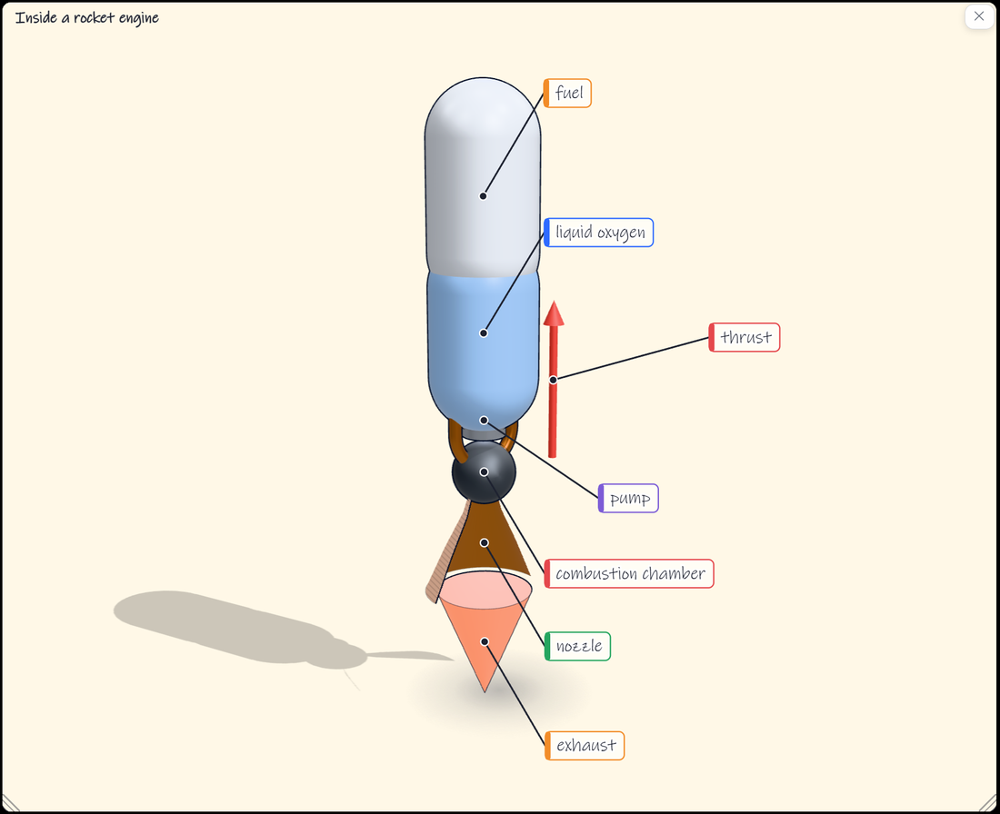
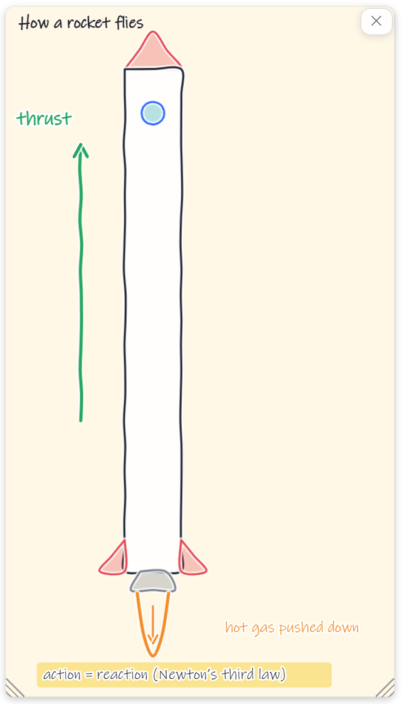

#  Hey Ganesh

**A Windows tutor for students: hold Ctrl+Alt, ask out loud, and it points at what you mean, explains it in speech, or draws it over your screen.**

```powershell
irm https://raw.githubusercontent.com/PranavJha-3000/HeyGanesh/main/installer/install-online.ps1 | iex
```

<p align="center"></p>

<p align="center">
  <a href="https://github.com/PranavJha-3000/HeyGanesh/releases/latest/download/HeyGanesh-win-x64.zip"></a>
  <a href="https://heyganesh-ai.vercel.app/"></a>
  <a href="docs/ai/ARCHITECTURE.md"></a>
</p>
<p align="center">
  <a href="https://github.com/PranavJha-3000/HeyGanesh/releases/latest"></a>
  
  
  
</p>

<p align="center">
  <a href="assets/readme/heyganesh-launch.mp4"></a>
  <br><sub>51-second launch video. Click to play. How it was made is under <a href="#about-the-launch-video">About the launch video</a>.</sub>
</p>

## Why it exists

Reading is the bottleneck in studying. After enough pages, words lose their meaning and start to disappear, and the
fix is rarely more text: it is a picture, drawn at the moment you are confused, about the thing you are looking at.
Existing assistants live in a chat window beside your work. Hey Ganesh answers on top of it.

## Try it in three steps

1. **Install.** The command at the top downloads the latest release and runs the steps below for you; read
   [`installer/install-online.ps1`](installer/install-online.ps1) first if you like. By hand: download the zip from the [latest release](https://github.com/PranavJha-3000/HeyGanesh/releases/latest),
   choose Extract All, then right-click `install.ps1` and Run with PowerShell. It installs for your account only and
   needs no admin rights. The app is not code-signed yet, so SmartScreen may warn: choose More info, then Run anyway.
2. **Add your keys.** The tray's **Keys…** screen opens on first run. Keys are stored in Windows Credential Manager.
3. **Ask.** Hold **Ctrl+Alt**, say "where is the Save button?" or "why does a longer wrench loosen a bolt?", and let go.

## What it does

| | |
|---|---|
| **Points** | Outlines the element you asked about, and never clicks or types for you. It reads the window's UI Automation tree first, plus up to 40 lines of on-screen text from Windows' built-in OCR, and lets a model choose from a ranked list of candidates. A vision model is only the fallback. |
| **Explains** | A tutor model answers academic and technical questions, grounded in what is on your screen, and speaks the answer. |
| **Draws** | For "how does..." questions the model writes a short program in a drawing language. A sandboxed worker runs it, a mark check runs before each pen stroke, and the strokes are paced by the speech. The program itself chooses 2D or 3D. |
| **Replays** | Every taught turn is saved locally. "Recent lessons" in the tray replays a stored drawing without calling any model. |
| **Remembers the session** | Follow-ups understand the last few turns of the current session. |
| **Lives in the tray** | No console window, optional start at login, a per-user installer. |

## See it work

These are captures from the repo's own drawing-stage test host (`DrawStageSmoke --snapshot`), taken after each lesson
finished drawing. Each is a program in the drawing language, run on the stage page with no network and no model call.

<table>
  <tr>
    <td width="50%" valign="top"><br><b>Jet engine.</b> A 3D cutaway: fan, compressor, combustion, turbine, thrust.</td>
    <td width="50%" valign="top"><br><b>The heart.</b> Smooth organic shapes, labelled by where the blood goes.</td>
  </tr>
  <tr>
    <td width="50%" valign="top"><br><b>3D printer.</b> Filament, hot end, print bed and the layers that stack up.</td>
    <td width="50%" valign="top"><br><b>Plugging in a camera.</b> A board, its camera slot and the ribbon cable, for a step-by-step how-to.</td>
  </tr>
  <tr>
    <td width="50%" valign="top"><br><b>Rocket engine.</b> Tanks, pump, chamber, nozzle and the thrust arrow.</td>
    <td width="50%" valign="top"><br><b>2D, hand drawn.</b> A rocket with its thrust arrow and "action = reaction".</td>
  </tr>
</table>

### About the launch video

The launch video is a staged demo built from real runs, not a recording of one session:

- **Drawings** were written by Claude, through the Claude Code CLI on a Claude plan, with the repo's planner
  evaluation tool (`PlannerEval --record --provider claude-code`). First stroke came after 2.4 s, 3.0 s, 2.1 s and
  1.9 s. 22 of the 25 automatic checks passed. The misses do not show on screen: the DNA model used 87 3D parts (the
  limit is 50), the engine lesson never said "crankshaft", and the sky lesson never said "wavelength".
- **Voices** are Gnani Timbre, through the app's own `GnaniTtsClient`.
- **Stage** is the app's real drawing-stage page, recorded in headless Chrome on top of mock study desktops (a lecture
  video, a textbook PDF, course notes, a photo). The desktops show no real brands or people.
- **Not shown:** live turn routing. The TypeSafe key used for the recording was rejected with HTTP 401.
- The 2 to 3 second wait before the first stroke is compressed in the edit, and the real number is on screen.

## How it works

```
Ctrl+Alt -> speech to text -> screen capture -> Turn Router: point | explain | lesson
   point   -> UI Automation + OCR candidates -> model picks one -> overlay outline
   explain -> Tutor Engine -> spoken answer
   lesson  -> Drawing Planner -> drawing program -> sandboxed stage, paced by speech
```

The process host is `HeyGanesh.App`; the tray (`HeyGanesh.Tray`) runs the same composition with no console. Modules:

| Module | Path | Role |
|---|---|---|
| App Shell | `src/Experience/HeyGanesh.App` | Process host, DPI awareness, wires the whole pipeline |
| Global Hotkey Monitor | `src/Platform/HeyGanesh.GlobalHotkeyMonitor` | Listen-only Ctrl+Alt push-to-talk, low-level keyboard hook |
| Screen Capture | `src/Platform/HeyGanesh.ScreenCapture` | On-demand multi-monitor frames through `Windows.Graphics.Capture` |
| Element Selection | `src/Perception/HeyGanesh.ElementSelection` | Primary path to find an element: UIA + OCR candidates, a model chooses |
| Vision | `src/Perception/HeyGanesh.Vision` | Fallback when Element Selection finds nothing; also double-checks low-confidence picks |
| Turn Router | `src/Intelligence/HeyGanesh.TurnRouter` | One model call per turn: point, explain or lesson |
| Tutor Engine | `src/Intelligence/HeyGanesh.TutorEngine` | The only component that answers the user; never touches the screen |
| Lesson Planner + Draw Stage | `src/Intelligence/HeyGanesh.LessonPlanner`, `src/Experience/HeyGanesh.DrawStage` | A lesson is a spoken drawing |
| Screen Overlay | `src/Platform/HeyGanesh.ScreenOverlay` | Click-through highlight window, excluded from capture |
| Voice | `src/Experience/HeyGanesh.Voice` | Speech in and out behind `IVoiceListener` and `ITtsClient` |
| Notes | `src/Foundation/HeyGanesh.Notes` | Local SQLite store through Windows' own `winsqlite3.dll` |
| Security | `src/Foundation/HeyGanesh.Security` | `KeyRing`: Credential Manager first, environment variable second |

### Engineering decisions worth knowing

- **Zero NuGet in the core modules.** They use Win32 P/Invoke and Windows SDK WinRT interop only. The drawing stage
  is the one assembly with a package reference (`Microsoft.Web.WebView2`).
- **Provider seams, not provider code.** Every model and voice is behind an interface (`IJevClient`, `IVisionClient`,
  `ITutorClient`, `ILlmClient`, `ITtsClient`, `IVoiceListener`), so the offline test hosts run the real pipeline against fakes.
- **Capture exclusion.** Every overlay window excludes itself from capture, so the app never photographs its own output.
- **Physical-pixel coordinates.** All boxes and monitor bounds are physical pixels under PerMonitorV2 DPI awareness.
- **Model-written code runs in a cage.** Drawing programs execute in a no-network Web Worker, one statement at a
  time, and a mark check runs before the pen touches the screen. Text from the screen is always fenced as untrusted.
- **Keys never leave a seam.** They are read per request and reported only as present, missing and length.
- **A fallback is decided in one place.** The Context Orchestrator, not the modules, decides when Vision runs.

Every decision has a dated record in [`docs/ai/DECISIONS.md`](docs/ai/DECISIONS.md).

## Voice and models

| Job | Provider | Key |
|---|---|---|
| Speech in | Gnani **Prisma** (`prisma-v3.0`) when a Gnani key is set, else a qwen-audio-agent Gateway | `GNANI_API_KEY` or `HEYGANESH_QWEN_GATEWAY_URL` |
| Speech out | Gnani **Timbre** (`timbre-v3.0`) when a Gnani key is set, else Fish Audio | `GNANI_API_KEY` or `FISH_AUDIO_API_KEY` |
| Tutor, lesson planner, vision fallback | DeepSeek (`deepseek-flash`) | `DEEPSEEK_API_KEY` |
| Element choice and turn routing | TypeSafe (`jev-1.13.0`) | `TYPESAFE_API_KEY` |

DeepSeek and TypeSafe keys are required. The Gnani key is optional but replaces the external Gateway and Fish. Prisma
listens with a local energy-based voice activity check and uploads one clip of up to 30 seconds per question.

## Requirements

- Windows 11 (built for `net8.0-windows10.0.22621.0`) and a microphone
- WebView2 runtime for the drawing stage (included with current Windows 11)
- The .NET 8 SDK to build from source (`global.json` pins 8.0.425)
- API keys as above, in Credential Manager (tray, **Keys…**) or as environment variables

## Build and run from source

```powershell
dotnet build HeyGanesh.sln -c Debug
src\Experience\HeyGanesh.Tray\bin\Debug\net8.0-windows10.0.22621.0\HeyGanesh.Tray.exe
```

The console host, `HeyGanesh.App.exe`, runs the same pipeline with testing flags: `--help`, `--keys`, `--set-key <name>`,
`--once`, `--lesson`, `--no-route`, `--no-speak`, `--no-notes`, `--no-context`.

Build the installer package (self-contained win-x64, about 80 MB zipped):

```powershell
powershell -NoProfile -ExecutionPolicy Bypass -File installer\build.ps1 -Zip
```

## Verification

Each module has a small smoke host under `tools/` that runs offline with fakes and exits non-zero on failure. The
list of checks, with the exact command and expected output for each, is [`docs/ai/TEST-CHECKLIST.md`](docs/ai/TEST-CHECKLIST.md).
CI (`.github/workflows/ci.yml`) runs the offline gates plus a forbidden-pattern scan and a secret scan. Examples:

```powershell
dotnet run --project tools/SecretSmoke -c Debug -- --assert-keyring
dotnet run --project tools/VoiceSmoke -c Debug -- --assert-gnani-tts
dotnet run --project tools/VoiceSmoke -c Debug -- --assert-gnani-stt
dotnet build tools/TraySmoke -c Debug -warnaserror
```

## Privacy

- Lessons stay on your PC, in `%LOCALAPPDATA%\HeyGanesh\notes.db`. Notes hold your question, the answer and any
  drawing program. They never hold screenshots, screen text or keys.
- A screen capture, or the names and text on screen, is sent to the model providers whose keys you added, only to
  answer the question you asked. Nothing is sent until you press Ctrl+Alt.
- The app's own overlay and lesson windows are excluded from its screen captures.

## Known limitations

- Windows only. Not code-signed yet, so SmartScreen warns on first run.
- The Gnani Prisma and Timbre clients follow Gnani's published API (`docs.gnani.ai`) and pass offline contract tests
  (VO-12, VO-13). They have not yet been run against the live service with a real key.
- Claude and Codex plan providers exist in `src/Providers/HeyGanesh.Providers.ClaudeCode` but are used by the
  evaluation tool only, not by the shipped app.
- No `LICENSE` file has been added yet. Third-party code under `src/Experience/HeyGanesh.DrawStage/Page` keeps its own MIT licence.
- Languages are English and Hindi through the configured Gnani language codes. Other languages are untested.

## For contributors

Read [`CONTRIBUTING.md`](CONTRIBUTING.md) first, then [`AGENTS.md`](AGENTS.md) and [`docs/ai/`](docs/ai/): `ARCHITECTURE.md` (modules), `FLOW.md` (call paths),
`TEST-CHECKLIST.md` (verification rows), `DECISIONS.md` (why things are the way they are), `HANDOVER.md` (current state).
Most rows run offline and need no keys.

## License

[MIT](LICENSE). The vendored drawing stage and three.js keep their own MIT notices (see Third-party code below).

## Credits and inspiration

Built for the **Gnani Great Indian AI Internship Challenge**, with Gnani Prisma and Timbre for voice.

- **[HeyClicky](https://heyclicky.com)** ([open-source project it grew out of](https://github.com/farzaa/clicky), MIT):
  the inspiration for Hey Ganesh. Hold a key, ask out loud, and an assistant answers on your screen. Hey Ganesh applies
  that idea to studying, and adds spoken drawings. Hey Ganesh is independent of HeyClicky and not affiliated with it.
- **[three.js](https://github.com/mrdoob/three.js)** r172 (MIT), vendored for the 3D figures.
- **[Papermorph](https://github.com/DozenTwelve/Papermorph)**: inspiration for turning dense course material into lessons.
- **[Anatomy](https://github.com/wheresryan22/anatomy)**: inspiration for clean isometric technical drawings.

### Third-party code

The drawing stage page, its prompts and its 3D figure engine are vendored from the MIT-licensed
[openclicky](https://github.com/prasanthsasikumar/openclicky), pinned file by file in
[`VENDOR.md`](src/Experience/HeyGanesh.DrawStage/VENDOR.md). The plan-provider launcher is ported from it. This notice is
kept because the MIT licence requires it.
